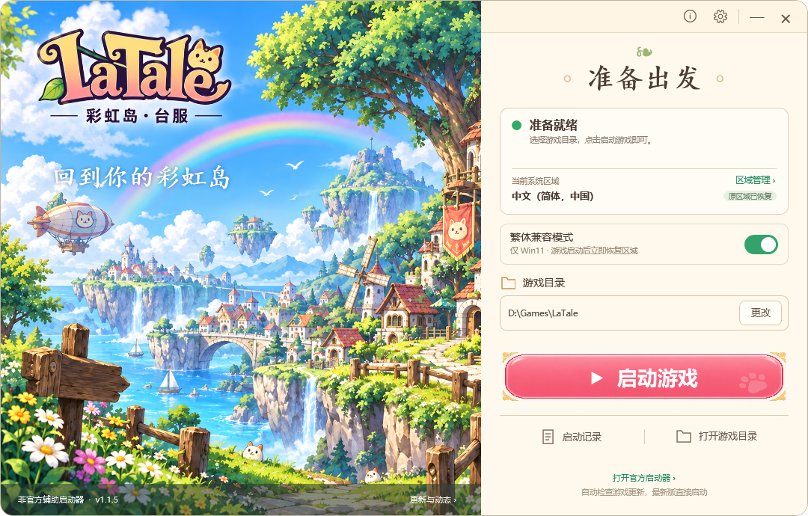

# LaTale Garden

彩虹岛台服的第三方启动器，解决 Windows 中文系统运行台服时的文字乱码问题。

[下载](https://github.com/visionki/latale-garden/releases/latest/download/LaTaleGarden.exe) · [版本记录](https://github.com/visionki/latale-garden/releases) · [反馈](https://github.com/visionki/latale-garden/issues)

---

## 快速开始

1. 下载 `LaTaleGarden.exe`，双击打开，无需安装。
2. 首次使用时点击「更改」，选择彩虹岛安装目录下的 `LaTaleLauncher.exe`。
3. 保持「繁体兼容模式」开启，点击「启动游戏」，出现管理员授权提示时允许。
4. 需要更新时：在官方启动器完成更新，不要点「开始游戏」，回到 Garden 点击「我已更新完成」。

本地数据保存在 `%LOCALAPPDATA%\LaTaleGarden`，EXE 本身可以放任意位置，不在旁边生成文件。

---

## 它做什么

台服客户端使用繁体编码（Big5/CP950），在简体中文系统上运行时，Windows 以系统代码页（通常 GBK/CP936）解读文字，导致乱码。常规解法是手动到「区域设置」把系统区域改成台湾，但修改后会影响其他程序，且完整生效需要重启。

Garden 在每次启动游戏时自动完成这个切换：记录当前区域 → 临时切换到繁体台湾 → 启动游戏 → 识别到本次游戏进程后立即还原原区域。整个过程不需要重启，退出 Garden 后系统恢复原样。

乱码修复依赖 Windows 的 `Set-WinSystemLocale` API，当前仅在 **Windows 11 64 位**上验证有效，不支持 Windows 10。启用 UTF-8 系统代码页（代码页 65001）时，临时切换无效，可改用标准启动。

---

## 启动流程

每次点击「启动游戏」，Garden 会先通过官方更新服务器（`patch-la.mangot5.com.tw`）下载游戏版本清单（约 INI 格式），对比本地的 `LaTaleLauncher.exe`、`LaTaleClient.exe`、`.SPF` 资源文件版本和附加文件 MD5。

- **游戏已是最新版**：直接用官方启动器的参数格式（`/Windowed /LoginServer:... /Run:VHIGH /LOCALE:TAIWAN`）启动客户端，跳过官方启动器。
- **需要更新**：打开官方启动器，等用户完成更新后点击「我已更新完成」，Garden 再次核对清单，通过后关闭官方启动器并进入兼容启动。

游戏进程识别通过路径 + PID + 创建时间三重核对，确认是本次启动的进程后立即恢复区域，无需等待游戏窗口出现或额外缓冲时间。

---

## 区域管理

Garden 在每次兼容启动前保存完整的区域快照（包括 `LocaleName`、`Default`、`ACP`、`OEMCP`、`MACCP`），写入会话目录，同时启动一个独立的守护进程。如果主进程异常退出，守护进程会接管并完成恢复。

「区域管理」页面分两列显示当前区域：一列来自注册表配置，一列来自新启动子进程的实际读数，两者不一致时会标注结果可能过期。可以在此手动恢复备份或直接切换简体/繁体（需退出游戏）。

---

## 兼容性说明

- Windows 11 64 位，.NET Framework 4.8 或更高版本。
- Windows 10 / 7 不支持乱码修复，可用于标准启动和区域记录查看。
- 临时区域切换期间，其他依赖非 Unicode 编码的程序可能受到影响。
- 系统区域手动切换（非临时切换）完整生效需要重启电脑。

---

## 项目说明

非官方工具，与游戏运营方无隶属关系。游戏内容及相关权益归其权利方所有。
由 [visionki](https://github.com/visionki) 开发，源码和版本记录在本仓库，问题反馈请前往 [GitHub Issues](https://github.com/visionki/latale-garden/issues)。
